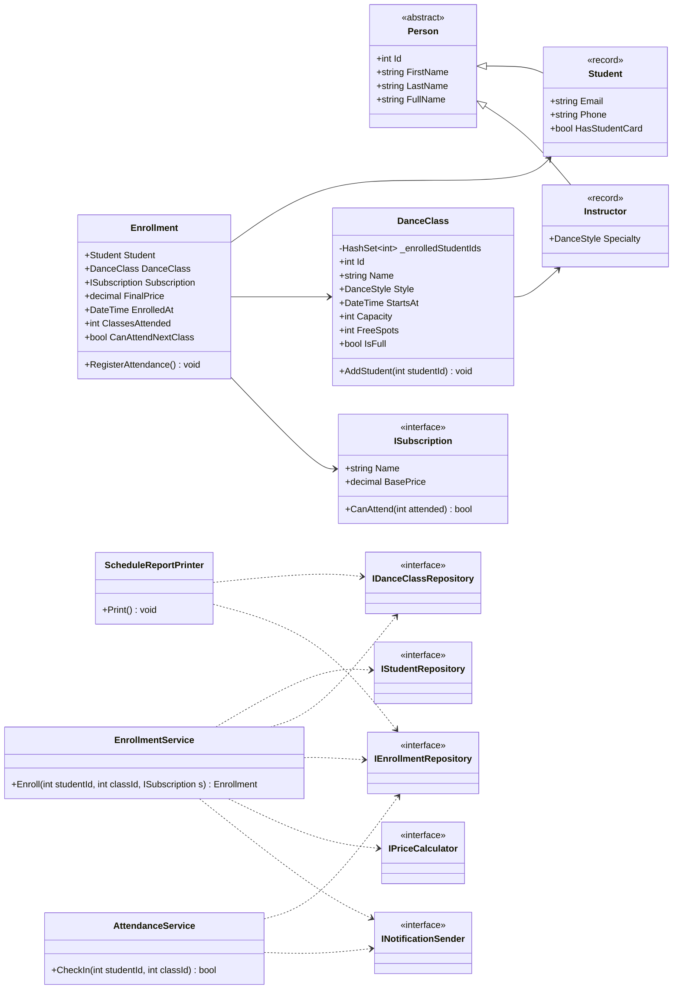
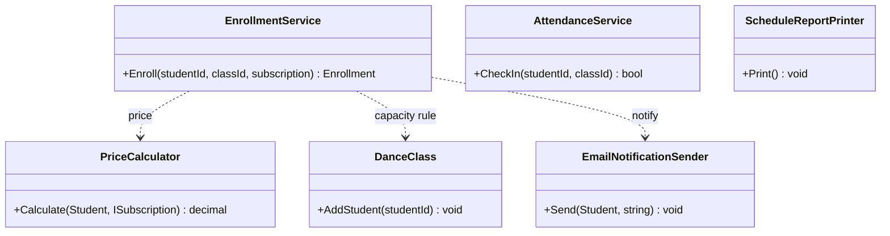
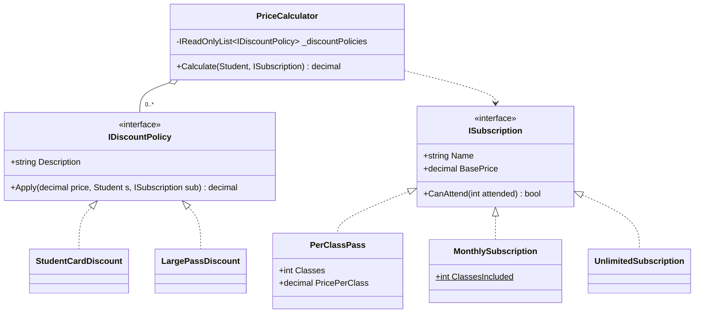
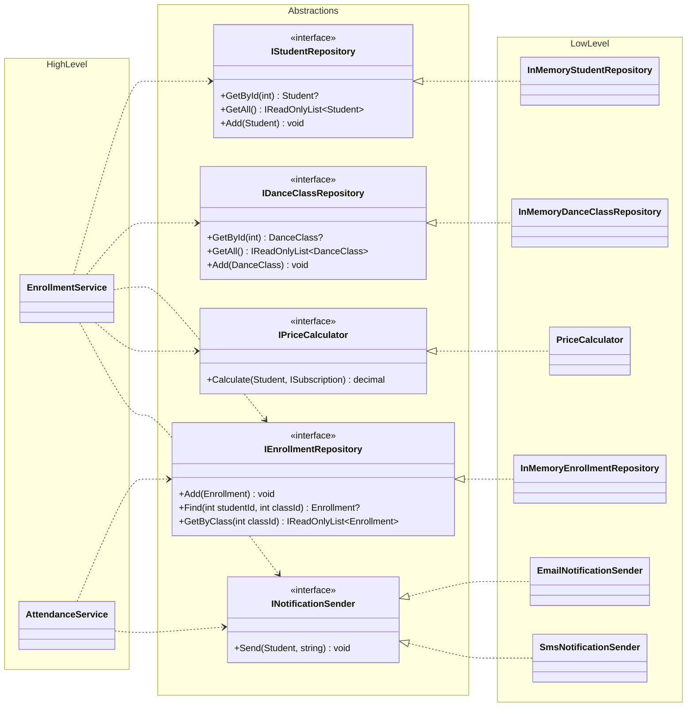

# Dance School Management — SOLID Principles

**Course:** Software Design Techniques and Mechanisms (TMPS) · **Laboratory work no. 1**
**Author:** _Name Surname, group_ · **Technology:** C# / .NET 10 (console application)

---

## 1. Objective

Design and implement a small object-oriented system that demonstrates **three SOLID principles**:

| Letter | Principle | Where it is applied |
|---|---|---|
| **S** | Single Responsibility Principle | `PriceCalculator`, `EnrollmentService`, `AttendanceService`, `ScheduleReportPrinter`, `DanceClass` |
| **O** | Open/Closed Principle | `ISubscription` (subscription types), `IDiscountPolicy` (promotions) |
| **D** | Dependency Inversion Principle | services depend on `I…Repository`, `INotificationSender`, `IPriceCalculator`, `TimeProvider` |

## 2. Domain

The application manages a **dance school**: students enroll in group classes (Salsa, Bachata, Hip‑Hop…)
using a subscription plan, the final price is computed by applying discount policies, students are notified
by e‑mail or SMS, and attendance is checked against the subscription limit.

Main entities:

- **Person** – abstract base with `FirstName`, `LastName` and the computed `FullName`.
- **Student** – a person who takes classes (may hold a student card → discount).
- **Instructor** – a person who teaches classes in a given style.
- **DanceClass** – a scheduled class with a limited capacity.
- **ISubscription** – the plan used to attend: `PerClassPass`, `MonthlySubscription`, `UnlimitedSubscription`.
- **Enrollment** – links a student, a class and a subscription; stores the paid price and attended classes.

## 3. Project structure

```
Lab1/
├── DanceSchool.slnx
├── src/DanceSchool.App
│   ├── Domain/                     entities + business invariants
│   │   └── Subscriptions/          ISubscription and its implementations (OCP)
│   ├── Abstractions/               interfaces the services depend on (DIP)
│   ├── Services/                   use cases (SRP)
│   │   └── Pricing/                PriceCalculator + IDiscountPolicy implementations (OCP)
│   ├── Infrastructure/
│   │   ├── Persistence/            in-memory repositories + seed data
│   │   └── Notifications/          e-mail / SMS senders (simulated)
│   ├── Presentation/               console report
│   └── Program.cs                  composition root (wires everything together)
└── tests/DanceSchool.Tests         xUnit tests
```

## 4. General class diagram



---

## 5. Single Responsibility Principle (SRP)

> *A class should have only one reason to change.*

**Without SRP** a single `DanceSchoolManager` would look up students, check capacity, compute discounts,
send e‑mails and print reports. A change in the discount rules, the e‑mail format or the report layout would
all modify the same class:

```csharp
// ❌ anti-example (not in the project)
public class DanceSchoolManager
{
    public void Enroll(int studentId, int classId, string plan)
    {
        var student = _db.Students.Find(studentId);          // persistence
        if (_db.Enrollments.Count(...) >= capacity) throw;   // business rule
        decimal price = plan == "monthly" ? 600 : ...;       // pricing
        if (student.HasStudentCard) price *= 0.85m;          // discounts
        new SmtpClient().Send(...);                          // notification
        Console.WriteLine(...);                              // presentation
    }
}
```

**With SRP** every responsibility has its own class:

| Class | Single responsibility | Reason to change |
|---|---|---|
| `DanceClass` | guards capacity / duplicate enrollment | rules of a class change |
| `PriceCalculator` | computes the final price | pricing algorithm changes |
| `EnrollmentService` | orchestrates the enrollment use case | enrollment flow changes |
| `AttendanceService` | validates and records check-ins | attendance rules change |
| `ScheduleReportPrinter` | formats the schedule | report layout changes |
| `InMemory…Repository` | stores data | storage technology changes |
| `Email/SmsNotificationSender` | delivers messages | delivery channel changes |



## 6. Open/Closed Principle (OCP)

> *Software entities should be open for extension, but closed for modification.*

**Without OCP** prices would be computed with a `switch` on the plan type, and every new plan or promotion
would require editing (and re-testing) that method:

```csharp
// ❌ anti-example
decimal price = plan switch { "pass" => n * 90, "monthly" => 600, "unlimited" => 1000 };
if (student.HasStudentCard) price *= 0.85m;
if (plan == "pass" && n >= 10) price *= 0.9m;
```

**With OCP** there are two extension points:

1. **`ISubscription`** – each plan knows its own name, base price and attendance limit.
   `EnrollmentService`, `Enrollment` and `AttendanceService` work with any implementation.
2. **`IDiscountPolicy`** – `PriceCalculator` receives a list of policies and applies them in order.
   A new promotion (e.g. *SiblingDiscount*, *SummerPromo*) is a **new class** registered in `Program.cs`;
   `PriceCalculator` is never edited.



Key code:

```csharp
public decimal Calculate(Student student, ISubscription subscription)
{
    var price = subscription.BasePrice;
    foreach (var policy in _discountPolicies)
        price = policy.Apply(price, student, subscription);
    return Math.Round(price, 2);
}
```

## 7. Dependency Inversion Principle (DIP)

> *High-level modules should not depend on low-level modules. Both should depend on abstractions.*

**Without DIP** `EnrollmentService` would create `new SqlStudentRepository()` and `new SmtpEmailSender()`
itself, so it could not be tested without a database and a mail server, and switching e‑mail → SMS would
mean editing the service.

**With DIP** the high-level services only know interfaces from `Abstractions/`. The concrete
implementations live in `Infrastructure/` and are chosen **once**, in the composition root (`Program.cs`):

```csharp
var enrollmentService = new EnrollmentService(
    students, classes, enrollments, priceCalculator,
    new EmailNotificationSender(output),      // e-mail for enrollments
    TimeProvider.System);
var attendanceService = new AttendanceService(
    enrollments,
    new SmsNotificationSender(output));       // SMS for check-ins – no service code changed
```

The tests use the same mechanism to inject a `FakeNotificationSender` instead of a real channel.



---

## 8. Running the project

Requirements: [.NET 10 SDK](https://dotnet.microsoft.com/download).

```bash
cd Lab1
dotnet run --project src/DanceSchool.App   # run the demo
dotnet test                                # run the unit tests
```

### Sample output

```
=== 1. Enrollments (price = subscription + discount policies) ===
    [EMAIL -> ana.popescu@mail.md] You are enrolled in 'Salsa Beginners' (Mon 19 Oct, 18:00) Plan: 10-class pass. Price: 688.50 MDL.
  OK    Ana Popescu -> Salsa Beginners
  ...

=== 2. Business rules ===
  ERROR Class 'Hip-Hop Choreo' is full (2/2).
  ERROR Student #2 is already enrolled in 'Salsa Beginners'.
  ERROR Student #9 does not exist.

=== 3. Check-ins (Victor has a 2-class pass) ===
  Check-in #1 for Victor Lungu: welcome!
  Check-in #2 for Victor Lungu: welcome!
    [SMS -> +373 69 444 444] Your 2-class pass for 'Bachata Sensual' is used up. Renew it to keep dancing!
  Check-in #3 for Victor Lungu: denied

=== 4. Weekly schedule ===
  Mon 18:00  Salsa Beginners  Salsa    with Elena Moraru     2/10 spots
      - Ana Popescu   10-class pass                        attended  1   paid   688.50 MDL
      - Ion Rusu      monthly subscription (8 classes)     attended  0   paid   600.00 MDL
  ...
```

### Tests

12 xUnit tests cover pricing and discount stacking, subscription limits, enrollment rules
(full class, unknown student) and check-in denial when a pass is used up.

## 9. Conclusions

- **SRP** kept every class small and focused; each one can be read, tested and changed on its own.
- **OCP** made subscription plans and promotions pluggable: adding a new plan or discount means adding a
  class, not editing existing, already-tested code.
- **DIP** decoupled the use cases from storage and notification technology. The same services run with
  in-memory repositories in the demo and with fakes in the tests, and could run with a real database
  or e‑mail gateway without any change in `Services/`.
